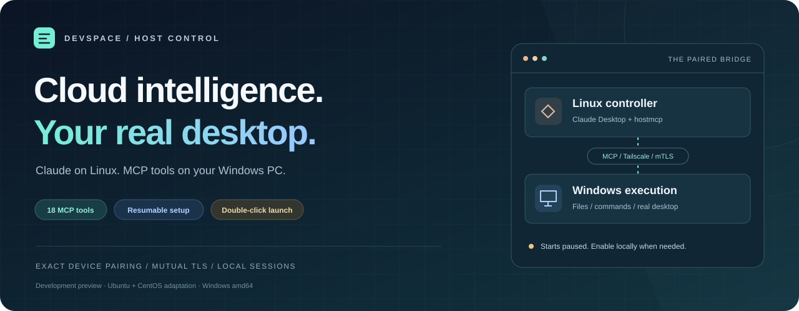
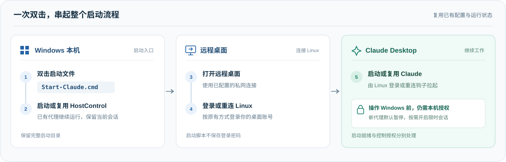
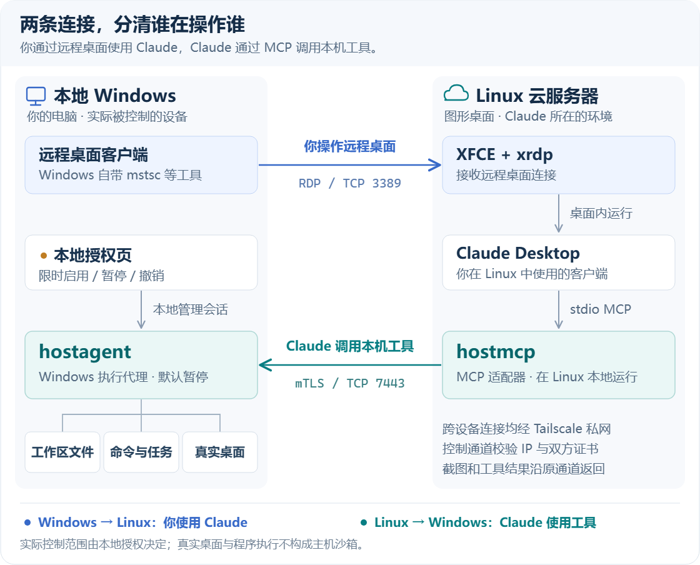
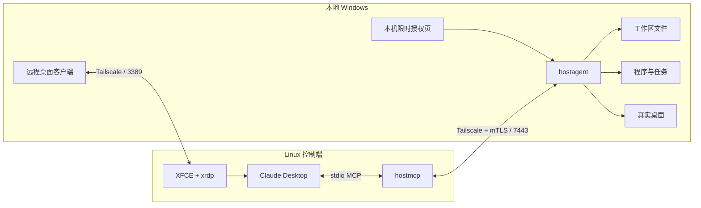

<div align="center">



# DevSpace Host Control

### 让云端 Claude，连接你的真实 Windows 工作现场。

**自动部署 · 断点续跑 · 双击启动 · 18 个 MCP 工具**

[](https://github.com/wcy-wcy1/devspace-host-control/actions/workflows/ci.yml) [](https://github.com/wcy-wcy1/devspace-host-control/releases/tag/v0.2.0-beta.2) [](#mcp-tools) [](hostcontrol/go.mod) [](LICENSE)

[**下载新版 Skill**](https://github.com/wcy-wcy1/devspace-host-control/releases/download/v0.2.0-beta.2/devspace-host-control.zip) · [快速开始](#quick-start) · [双击启动](#one-click) · [系统架构](#architecture) · [验证记录](#verification)

<sub>Linux 上运行 Claude Desktop，Windows 上执行文件、命令与桌面操作。<br/>精确设备配对，双向证书认证，控制会话由本机限时开启。</sub>

</div>

---

## 一套工具，从安装到下一次打开

DevSpace Host Control 将 **Go 主机控制模块**和**自包含 Codex Skill**放进同一个项目。你通过远程桌面使用 Linux 上的 Claude Desktop；Claude 通过 MCP 调用 Windows 本地 HostControl 程序，处理文件、执行任务、观察与操作真实桌面。

<table>
<tr>
<td width="50%" valign="top">

### 🧭 自动部署，接着上次继续

探测两端环境，复用已有安装与配对。阶段进度需要实际证据；设备地址或前置条件改变后，相关验收重新进行。

</td>
<td width="50%" valign="top">

### 🚀 配好一次，之后双击

双击 `Start-Claude.cmd`，启动或复用 Windows 程序，打开远程桌面，在 Linux 登录或重连时拉起 Claude。

</td>
</tr>
<tr>
<td width="50%" valign="top">

### 🔗 从文件到真实桌面

18 个 MCP 工具覆盖工作区文件、程序任务、截图、UIA 检查、鼠标键盘与浏览器打开。文本剪贴板默认双向开启。

</td>
<td width="50%" valign="top">

### 🔐 配对明确，授权可停

精确 Tailscale 设备地址、mTLS 与证书指纹固定。Windows 程序默认暂停，支持本机限时开启、暂停和持久撤销。

</td>
</tr>
</table>

> [!IMPORTANT]
> **v0.2.0-beta.2 是开发验证版本。** 已有一次 CentOS 原机部署经验；新版离线测试与运行程序完整性检查通过。完整新装、一键入口的真实冷启动/重连、实际键鼠操作仍需现场验收。[查看验证范围 →](#verification)

<a id="quick-start"></a>
## 快速开始

### 01 · 取走完整工具包

| 下载 | 内容 |
| :--- | :--- |
| [**devspace-host-control.zip**](https://github.com/wcy-wcy1/devspace-host-control/releases/download/v0.2.0-beta.2/devspace-host-control.zip) | 自包含 Skill：运行程序、源码、自动化、安装与启动脚本、排错指南 |
| [devspace-hostcontrol-source.zip](https://github.com/wcy-wcy1/devspace-host-control/releases/download/v0.2.0-beta.2/devspace-hostcontrol-source.zip) | 独立 Go 模块源码，适合研究和二次开发 |
| [SHA256SUMS.txt](https://github.com/wcy-wcy1/devspace-host-control/releases/download/v0.2.0-beta.2/SHA256SUMS.txt) | 两个压缩包的 SHA256 校验值 |

也可以直接使用仓库中的完整 Skill：

```bash
git clone https://github.com/wcy-wcy1/devspace-host-control.git
cd devspace-host-control
python scripts/verify_repository.py
```

### 02 · 安装 Skill，告诉 Codex 你的目标

将压缩包里的 `devspace-host-control/` 放入 Codex 的 skills 目录。默认是 `~/.codex/skills/`；设置了 `CODEX_HOME` 时，使用该目录下的 `skills/`。更新已有版本前先备份。

```powershell
$skillBase = if ($env:CODEX_HOME) { Join-Path $env:CODEX_HOME 'skills' } else { Join-Path $env:USERPROFILE '.codex/skills' }
Expand-Archive -LiteralPath ./devspace-host-control.zip -DestinationPath $skillBase
```

在能够发现该 Skill 的 Codex 会话中说：

```text
使用 $devspace-host-control，自动部署 Linux Claude Desktop 控制我的 Windows。
先检查现有环境，复用已有配置；缺少必要信息或需要我登录时再问我。
```

**Codex 执行安装、策略配置、配对与验证。** Tailscale/Claude 登录、UAC 和本机限时授权由用户交互完成。已有服务器、系统选择和工作区信息会复用；不要在聊天中发送密码、API 密钥或私钥。

### 03 · 按你的环境选路径

| 位置 | 支持范围 | 说明 |
| :--- | :--- | :--- |
| **Linux 控制端** | Ubuntu 22.04 / 24.04；运行程序 amd64 / arm64 | XFCE、xrdp、Claude Desktop、Tailscale、`hostmcp` |
| **CentOS 适配** | CentOS Stream 9 x86_64 | 需要明确选择原机适配；核对官方签名与包哈希后使用 Debian 包 |
| **Windows 执行端** | Windows amd64，交互式登录会话 | Tailscale、RDP 客户端、`hostagent.exe`、`hostctl.exe` |

Claude Desktop 官方不支持 CentOS，本项目提供兼容适配；Ubuntu 仍是主要安装路径。Go 成品运行不需要 Go SDK、Docker 或 Kubernetes，部署脚本另需 Python 3、Bash / PowerShell。

部署时还会核对**机房时区**：按用户确认的机房地区选择 IANA 时区，让 Linux 系统、远程桌面和 Claude 跟随它；不会照搬 Windows 本机时区。会单独检查 NTP、应用覆盖与浏览器缓存。[时区配置指南 →](skills/devspace-host-control/references/timezone.md)

📖 [自动化与续跑](skills/devspace-host-control/references/automation.md) · [部署与证书配对](skills/devspace-host-control/references/operations.md) · [安装故障诊断](skills/devspace-host-control/references/troubleshooting.md)

<a id="one-click"></a>
## 下一次，只需双击入口

配置完成后，保留为这台设备生成的**整个启动目录**。下次双击 **`Start-Claude.cmd`**，即可接着使用：

<p align="center">
  
</p>

| 使用体验 | 具体行为 |
| :--- | :--- |
| **接着上次继续** | 复用已运行的同一代理，保留当前会话；进程或配置不匹配时明确报错。 |
| **正常登录即可** | 使用原有 RDP 账号；启动脚本不保存 SSH/RDP 密码，不复制配对私钥。 |
| **控制权留在本机** | 新代理默认暂停；需要操作 Windows 时，在本机控制页开启限时会话。 |
| **文字随手复制** | 默认双向文本剪贴板，可显式关闭；文件、图片、磁盘和设备共享保持关闭。 |

Linux 通过所选用户的 XFCE autostart 和 xrdp 重连钩子启动 Claude，不创建 Windows 开机任务。生成步骤、验证和移除方法见 [双击启动指南](skills/devspace-host-control/references/launcher.md)。

<a id="architecture"></a>
## 两条连接，分清谁在操作谁

[](docs/assets/architecture.svg)

| 通道 | 方向 | 用途 |
| :--- | :--- | :--- |
| **远程桌面** | Windows → Linux · TCP 3389 | 你打开并使用 Claude Desktop |
| **工具调用** | Linux → Windows · TCP 7443 | Claude 经本地 stdio MCP 适配器和双向 TLS 调用 HostControl |

这里的 Windows“代理”是**执行本机操作的 HostControl 程序**。`hostmcp` 由 Linux Claude Desktop 启动；Codex Skill 负责安装和维护工作流，Claude 实际接入的是 MCP。

<details>
<summary><b>组件职责与可编辑架构</b></summary>

| 组件 | 所在位置 | 责任 |
| :--- | :--- | :--- |
| `hostagent` | Windows | 身份、会话、文件、任务与 Win32/UIA 桌面后端 |
| `hostmcp` | Linux | 将 stdio MCP 工具调用转换为配对私网请求 |
| `hostctl` | 两端 | 本地密钥、CSR、证书审批和指纹核对 |
| Skill / Python / PowerShell | Codex 与部署设备 | 环境发现、策略事务、安装、配对、启动和验收 |



</details>

<a id="mcp-tools"></a>
## 18 个工具，连接实际工作

| 能力 | MCP 工具 | 行为与边界 |
| :--- | :--- | :--- |
| **会话状态** | `host_status` · `session_info` | 本地授权状态、能力与期限；需要有效会话 |
| **工作区文件** | `fs_list` · `fs_read` · `fs_write` · `fs_move` | UTF-8 文本 ≤ 1 MiB；覆盖需旧哈希并生成备份 |
| **程序与任务** | `exec_start` · `exec_poll` · `exec_cancel` | 参数化执行、超时、有限输出和进程树取消 |
| **桌面观察** | `desktop_windows` · `desktop_inspect` · `desktop_capture` | 窗口、最多 500 个 UIA 元素、窗口可见区域截图 |
| **键鼠输入** | `desktop_focus` · `desktop_click` · `desktop_type` · `desktop_key` · `desktop_scroll` | 聚焦、点击、Unicode、组合键与滚轮 |
| **浏览器入口** | `browser_open` | 默认浏览器打开 HTTP/HTTPS 页面，后续使用桌面工具 |

截图帧绑定窗口与位置，有效期 **30 秒**；每次实际输入消费一帧。失焦、窗口移动或帧过期会拒绝输入，需重新观察。UIA 并非所有应用都支持，截图也可能包含遮挡窗口。

<details>
<summary><b>配置完成后，怎样让 Claude 做第一次连接测试？</b></summary>

在 Linux Claude Desktop 中，使用一个可删除的工作区测试文件：

```text
使用 my-windows-pc，先调用 host_status。
在 work 工作区新建 claude-test.txt，内容为“Claude connection test”。
读回文件并报告真实工具结果；失败时报告错误，不模拟成功。
```

电脑端先开启本机限时会话。文件 API 支持文本读取；PDF、Word、图片解析和完整二进制下载需要另行处理。桌面输入验收使用可丢弃的测试窗口，并遵守焦点和新鲜帧检查。

</details>

## 可靠性，从实际安装问题里改进

| 遇到的问题 | 统一版本的处理 |
| :--- | :--- |
| 修改剪贴板后登录成功，桌面却无法启动 | 按行修改 INI，保留 Xorg/Xvnc 重复 `param=` 顺序；有歧义或参数损坏时拒绝写入 |
| CentOS 登录后密钥环不解锁、Claude 用户目录异常 | 补齐 PAM 依赖，调整 `substack` 顺序，正确创建用户目录中间层 |
| 策略“保存了”，实际仍然全部互通 | 读取完整文档，条件保存并读回；不把聊天回复当作有效策略证据 |
| 自动化中断后重复安装、丢失现场状态 | 记录观察证据，复用现有安装，前置条件变化时使依赖阶段失效 |
| PowerShell 7 影响 Windows PowerShell UIA 子进程 | 在可见启动器中隔离模块路径，退出后恢复环境 |

配置工具默认预览；应用时备份、检查并发修改、原子替换单个文件，部分失败时尝试回滚自己的写入。不会为修复剪贴板自动注销或重启正在使用的桌面。[部署改进记录 →](docs/deployment-reliability.md)

<a id="verification"></a>
## 验证透明，才能放心迭代

**2026-11-11 · 统一版本的实际检查记录**

| 验证层次 | 结果 |
| :--- | :--- |
| **Windows 离线测试** | **66 通过，0 跳过**；新启动模拟同时覆盖 PowerShell 7 与 Windows PowerShell 5.1 |
| **CentOS 隔离测试** | **60 通过，6 跳过**；跳过 Windows / PowerShell 专属场景 |
| **脚本与成品完整性** | Bash/PowerShell 语法与安装预览通过；6 个运行程序哈希/架构通过；32 个 Go 源码镜像一致 |
| **已有现场记录** | RDP 登录、Claude 账号登录与 MCP 连接日志、Windows 文件操作、命令执行、窗口截图 |
| **启动器现场配置** | 登录/重连钩子应用及重复应用通过；识别现有代理，Claude helper 返回 `already_running` |
| **仍待现场验收** | 新脚本完整新装、真实双击冷启动/重连、实际键鼠输入、文件/图片剪贴板拒绝、多屏与 DPI |

离线测试使用假代理与夹具，不能证明真实桌面全部可用。当前未实现 DOM/Playwright 工具、UIA 元素动作派发、交互式 ConPTY、匿名中继和证书自动续期。

[统一版本记录](docs/unified-release.md) · [原始构建证据](skills/devspace-host-control/assets/build-evidence.md) · [验收场景](skills/devspace-host-control/references/verification.md) · [CI 运行结果](https://github.com/wcy-wcy1/devspace-host-control/actions)

## 权限与数据边界

> **精确配对限制连接；本地授权决定是否执行。真实桌面与程序执行仍具有当前用户权限。**

- **网络与身份**：精确设备地址、完整 Tailscale 策略、主机防火墙、TLS 1.3 和双方指纹固定共同限制连接。新增精确放行不会抵消已有广泛规则。
- **文件与桌面**：文件 API 有工作区根限制；任意程序与 GUI 不受该根目录沙箱约束。截图、UIA 文本、窗口标题和命令输出可能含本机信息。
- **密钥与会话**：私钥在所属设备生成，不跨设备复制；Windows 使用当前用户 DPAPI 与目录 ACL。会话可暂停与持久撤销，程序退出可停止控制。
- **可见启动**：不安装隐藏服务、Windows 开机任务或提权绕过。锁屏/UAC 限制按实际失败返回；Claude 的登录/重连自启只配置给所选 Linux 用户。
- **实际限制**：Tailscale 可能暴露公网端点元数据；完整 GUI 控制也可能看到或操作本地授权页。本项目不提供匿名网关或“零指纹”保证。

证书叶子有效期三个月、CA 一年，续期需要显式配对。操作去重仅保存在当前进程中，未知结果不能盲目重试。[完整边界说明 →](skills/devspace-host-control/references/privacy.md)

## 开发与二次构建

```text
devspace-host-control/
├── hostcontrol/                      # 维护的 Go 源码：agent / MCP / CLI
├── skills/devspace-host-control/
│   ├── SKILL.md                     # 自动部署与维护入口
│   ├── scripts/                     # 发现、策略、安装、启动、诊断与测试
│   ├── references/                  # 操作、续跑、启动、隐私与验收指南
│   └── assets/                      # 六个成品、源码镜像与校验记录
├── docs/                            # 架构图与真实改进记录
└── scripts/                         # 一致性验证与发布打包
```

```bash
# 仓库根目录：离线检查与包完整性
python -m unittest discover -s skills/devspace-host-control/scripts -p 'test_*.py' -v
python scripts/verify_repository.py

# Go 模块目录：实现测试与静态检查
cd hostcontrol
go test ./... -count=1
go vet ./...
```

<details>
<summary><b>构建运行程序和发布包</b></summary>

在仓库根目录使用 Windows PowerShell：

```powershell
$runtimeDir = Join-Path (Get-Location) 'skills/devspace-host-control/assets/runtime'
./hostcontrol/build.ps1 -OutputDirectory $runtimeDir
python scripts/package.py
```

`hostcontrol/` 是维护源码，Skill 中的 `assets/source/hostcontrol/` 是分发镜像。打包同步镜像并生成 `dist/`；修改 Go 实现后须重新构建、测试及更新证据，打包本身不代替验证。运行程序没有第三方 Go 依赖。

</details>

## 项目出处与许可

项目源自对 [DevSpace](https://github.com/loft-sh/devspace) 的源码研究，新增独立的主机控制模块。此仓库发布新增模块及 Skill，不包含完整上游 Kubernetes 项目，也未接入原 `devspace` CLI；不是 DevSpace 或 Anthropic 的官方产品。

研究基线：[DevSpace `8ff6260`](https://github.com/loft-sh/devspace/tree/8ff6260787edacfa2c0d30d1ff62358d36d482bc)。新增模块借鉴命令执行、同步和通道组织思路，重新实现主机身份、MCP 与 Windows 后端。

采用 **[Apache-2.0](LICENSE)**。出处见 [NOTICE](NOTICE)，保留的上游许可见 [LICENSE.devspace](skills/devspace-host-control/assets/LICENSE.devspace)。

---

<div align="center">

**从一次配置，到下一次双击。**

[下载 Skill](https://github.com/wcy-wcy1/devspace-host-control/releases/tag/v0.2.0-beta.2) · [阅读自动化指南](skills/devspace-host-control/references/automation.md) · [反馈问题](https://github.com/wcy-wcy1/devspace-host-control/issues)

</div>
