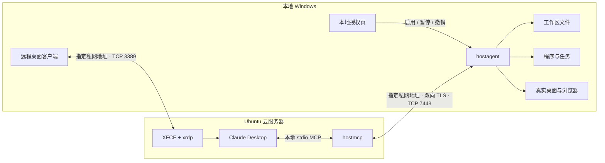

<div align="center">


**在 Ubuntu 上使用 Claude Desktop，通过受限私网操作你的真实 Windows 电脑。**

[](https://github.com/wcy-wcy1/devspace-host-control/actions/workflows/ci.yml)
[](https://github.com/wcy-wcy1/devspace-host-control/releases)
[](hostcontrol/go.mod)
[](skills/devspace-host-control/SKILL.md)
[](LICENSE)

[快速开始](#快速开始) · [工作原理](#工作原理) · [18-个工具](#18-个工具) · [验证状态](#验证状态) · [隐私边界](#隐私边界)

</div>

---

## 这是什么

DevSpace Host Control 包含一个 **HostControl 项目**和一个**自包含 Codex Skill**：你从本地 Windows 远程登录 Ubuntu，在 Ubuntu 图形桌面里使用 Claude Desktop；Claude 通过 MCP 调用本机代理，读写指定工作区、运行程序、观察窗口并操作鼠标键盘。

项目源自对 [DevSpace](https://github.com/loft-sh/devspace) 的源码研究，新增了独立主机控制模块。**本仓库发布新增模块及 Skill，不包含完整上游 Kubernetes 项目，也未接入原 `devspace` CLI。** 这不是 DevSpace 或 Anthropic 的官方产品。

> **当前版本：v0.1.0 · 开发验证阶段。** 已完成自动测试和跨平台编译；实际 Ubuntu 安装、Claude 工具发现及真实桌面联调仍需部署验收。真实桌面控制不等于环境沙箱，也不保证零指纹泄露。

## 设计重点

| 能力 | 实现 |
| :--- | :--- |
| **指定设备访问** | 精确 Tailscale IP 校验，握手前过滤来源，配合完整 tailnet 策略与主机防火墙 |
| **双向身份认证** | TLS 1.3、CA 验证、双方证书指纹固定；私钥各自在所属设备生成 |
| **本地会话控制** | 默认暂停，限时启用、暂停和持久撤销；远端没有启用会话的工具 |
| **真实桌面能力** | Win32 截图、聚焦、Unicode 输入、键盘与滚轮；系统 UIA 元素检查 |
| **可审查的 Skill** | 包含源码、运行程序、部署脚本、哈希清单与实际验证记录；脚本默认预览 |
| **轻量运行依赖** | Go 标准库实现，无第三方 Go 依赖；成品运行不要求 Go、Docker 或 Kubernetes |

## 工作原理

[](docs/assets/architecture.svg)

<details>
<summary>查看可编辑的 Mermaid 架构源码</summary>



</details>

**两条独立连接：** Windows → Ubuntu 用于远程桌面；Ubuntu → Windows 用于工具调用。MCP 适配器在 Ubuntu 本地运行，由 Claude Desktop 启动，跨设备采用 HTTPS JSON RPC。

| 组件 | 所在设备 | 责任 |
| :--- | :--- | :--- |
| `hostagent` | Windows amd64 | 身份、会话、文件、任务和真实桌面后端 |
| `hostmcp` | Linux amd64 / arm64 | Claude Desktop 的 stdio MCP 适配器 |
| `hostctl` | 两端 | 本地密钥生成、CSR、证书审批与指纹核对 |
| `devspace-host-control` Skill | Codex 环境 | 组织安装、配对、配置、验证和维护；Claude Desktop 接入的是 MCP |

## 快速开始

### 1 · 下载成品

前往 **[Releases](https://github.com/wcy-wcy1/devspace-host-control/releases/latest)**，下载：

- `devspace-host-control.zip`：完整 Skill，含六个运行程序和源码。
- `devspace-hostcontrol-source.zip`：独立 Go 模块源码。
- `SHA256SUMS.txt`：上述压缩包的 SHA256。

也可以克隆本仓库；`skills/devspace-host-control/` 已包含自包含 Skill：

```bash
git clone https://github.com/wcy-wcy1/devspace-host-control.git
cd devspace-host-control
python skills/devspace-host-control/scripts/verify_bundle.py
```

### 2 · 安装 Skill

将 `devspace-host-control.zip` 中的同名文件夹放入 Codex 的 skills 目录。默认路径为 `~/.codex/skills/`；设置了 `CODEX_HOME` 时使用该目录下的 `skills/`。已有同名 Skill 时先备份再更新。

Windows PowerShell 示例：

```powershell
$skillBase = if ($env:CODEX_HOME) { Join-Path $env:CODEX_HOME 'skills' } else { Join-Path $env:USERPROFILE '.codex/skills' }
Expand-Archive -LiteralPath ./devspace-host-control.zip -DestinationPath $skillBase
```

在能够发现该 Skill 的 Codex 会话中调用：

```text
$devspace-host-control 帮我部署 Ubuntu Claude Desktop 控制本机 Windows
```

**创建 Skill 或研究代码时无需提供服务器参数。** 部署时再收集两端系统、Tailscale 地址、现有 SSH 连接方式和 Windows 工作区目录。不要在聊天中发送密码、私钥或登录令牌。

### 3 · 按设备完成部署

| 设备 | 所需组件 |
| :--- | :--- |
| Ubuntu | 图形桌面、xrdp/xorgxrdp、Claude Desktop、Tailscale、`hostmcp` / `hostctl` |
| Windows | RDP 客户端、Tailscale、`hostagent.exe` / `hostctl.exe`、交互式登录会话 |

自动安装脚本目标为 Ubuntu **22.04 / 24.04**。预编译 Linux 程序支持 **amd64 / arm64**；Windows 原生桌面后端支持 **amd64**。部署脚本另需 Python 3、Bash / PowerShell；运行 Go 成品不需要开发 SDK。

完整流程见 **[部署与配对指南](skills/devspace-host-control/references/operations.md)**：检查完整网络策略 → 预览配置 → 安装桌面组件 → 两端各自生成私钥 → 交换公开 CSR / 证书 → 配置 Claude MCP → Windows 本地限时授权 → 验收。

<details>
<summary><b>只预览安装与防火墙，不应用更改</b></summary>

以下使用示例私网地址，部署时必须替换为真实设备地址。

```bash
bash skills/devspace-host-control/scripts/ubuntu-desktop.sh \
  --plan --windows-ip 100.80.0.1 --ubuntu-ip 100.80.0.2 --desktop-user worker
```

```powershell
./skills/devspace-host-control/scripts/windows-firewall.ps1 `
  -WindowsIP 100.80.0.1 -UbuntuIP 100.80.0.2 -AgentExe 'C:/HostControl/hostagent.exe'
```

需要显式 `--apply` / `-Apply` 才修改系统。Ubuntu 脚本要求现有非 root 桌面用户、已登录的 Tailscale 及审查后的完整策略文件，拒绝直接改造正在运行的 xrdp。

</details>

## 18 个工具

| 范围 | MCP 工具 | 行为与限制 |
| :--- | :--- | :--- |
| 状态 | `host_status` · `session_info` | 授权状态、能力与期限；需要有效本地会话 |
| 文件 | `fs_list` · `fs_read` · `fs_write` · `fs_move` | 显式工作区内操作；UTF-8 ≤ 1 MiB；覆盖需旧哈希并生成备份 |
| 执行 | `exec_start` · `exec_poll` · `exec_cancel` | 参数化程序执行、超时、有限输出和进程树取消 |
| 观察 | `desktop_windows` · `desktop_inspect` · `desktop_capture` | 窗口、最多 500 个 UIA 元素、窗口可见区域截图 |
| 输入 | `desktop_focus` · `desktop_click` · `desktop_type` · `desktop_key` · `desktop_scroll` | 聚焦、点击、Unicode、组合键与滚轮 |
| 浏览器 | `browser_open` | 默认浏览器打开 HTTP/HTTPS URL，后续使用桌面工具 |

截图帧绑定窗口与位置，有效期 **30 秒**；每次实际输入消费一帧，下一次输入需要重新观察。窗口移动、失焦或帧过期会拒绝输入。截图可能包含遮挡窗口，UIA 并非所有应用都支持。

**当前未实现：** DOM / Playwright 工具、UIA 元素动作派发、交互式 ConPTY、匿名中继和证书自动续期。

## 验证状态

初始打包验证记录见 **[build-evidence.md](skills/devspace-host-control/assets/build-evidence.md)**。CI 状态反映当前提交的自动检查。

| 检查 | 初始交付结果 |
| :--- | :--- |
| Windows Go 测试 | **13 通过 · 1 跳过 · 0 失败**；跳过真实桌面截图 |
| 配置脚本测试 | **4 通过**，包含拒绝附加全放行策略 |
| 身份与会话 | 回环 mTLS、错误身份/来源拒绝、暂停/过期、重启后撤销 |
| 文件与任务 | 遍历与 junction 越界、写入冲突、Job Object 子进程取消、输出上限 |
| MCP 可执行程序 | 初始化、通知及 18 个工具 schema 输出通过 |
| 构建与完整性 | 六个程序交叉编译；SHA256、文件大小与 PE / ELF 架构校验通过 |
| 现场部署 | **待验收**：Ubuntu 安装、Claude 实际工具发现、真实 UIA / 键鼠、多屏与 DPI、两端有效防火墙规则 |

CI 在 Windows 与 Ubuntu 上运行 Go 测试、`go vet`、Python 测试及 Skill 完整性检查；不会控制真实桌面或部署服务。Linux 程序能交叉编译不等于 Linux GUI 已通过验收。

## 隐私边界

**IP 白名单约束连接来源，证书约束设备身份；它们不能隔离已授权的真实桌面。**

- 文件 API 使用工作区根限制；任意程序和 GUI 具有当前 Windows 用户权限，**不是沙箱**。
- 截图、UIA 文本、窗口标题和命令输出可能包含本机身份，并会作为工具结果返回给 Claude。
- Tailscale 加密不保证对端不知道公网端点元数据；此项目没有匿名网关或“零指纹”承诺。
- 完整 tailnet 策略中的放行是叠加的；添加精确规则不能抵消已有广泛放行。
- 私钥不跨设备传输；Windows 使用当前用户 DPAPI 和目录 ACL，不能防御同用户已失陷进程。
- 默认暂停与本地控制页提供操作入口；拥有完整 GUI 权限的控制方也可能操作该页面，因此它不是独立硬件授权边界。
- 不安装隐藏服务、开机任务或提权绕过；锁屏和 UAC 失败按实际限制返回。

更多说明见 **[隐私与权限边界](skills/devspace-host-control/references/privacy.md)**。证书叶子有效期三个月、CA 一年；撤销持久保存，续期需显式配对操作。操作去重仅保存在当前进程中，未知结果不能盲目重试。

## 开发与打包

```text
devspace-host-control/
├── hostcontrol/                         # 维护的 Go 模块
│   ├── cmd/{hostagent,hostmcp,hostctl}/
│   ├── internal/host/                   # 认证、文件、任务、Win32、UIA
│   └── build.ps1
├── skills/devspace-host-control/        # 可直接安装的完整 Skill
│   ├── SKILL.md
│   ├── scripts/                         # 配置、安装、检查
│   ├── references/                      # 运维、隐私、验收
│   └── assets/                          # 运行程序、源码镜像、校验与证据
├── scripts/                            # 仓库一致性校验和发布打包
└── .github/workflows/ci.yml
```

在 `hostcontrol/` 内运行：

```bash
go test ./... -count=1
go vet ./...
```

在仓库根目录运行：

```bash
python skills/devspace-host-control/scripts/test_configure.py -v
python scripts/verify_repository.py
```

Windows PowerShell 构建及打包：

```powershell
$runtimeDir = Join-Path (Get-Location) 'skills/devspace-host-control/assets/runtime'
./hostcontrol/build.ps1 -OutputDirectory $runtimeDir
python scripts/package.py
```

`hostcontrol/` 是维护源码；打包脚本同步到 Skill 的源码镜像、刷新程序校验值并生成 `dist/` 压缩包。修改实现后需重新构建、测试，并更新真实验证记录；打包本身不会替你证明程序正确。

## 上游与许可

上游研究基线：[DevSpace `8ff6260`](https://github.com/loft-sh/devspace/tree/8ff6260787edacfa2c0d30d1ff62358d36d482bc)。新增模块借鉴其命令执行、同步和通道组织思路，重新实现主机身份、MCP 及 Windows 后端；不将 Kubernetes 内部通道原样暴露为主机服务。

本项目采用 **[Apache-2.0](LICENSE)**。出处说明见 [NOTICE](NOTICE)，保留的上游许可见 [LICENSE.devspace](skills/devspace-host-control/assets/LICENSE.devspace)。

---

<div align="center">
<sub>明确授权 · 精确配对 · 真实边界</sub>
</div>
