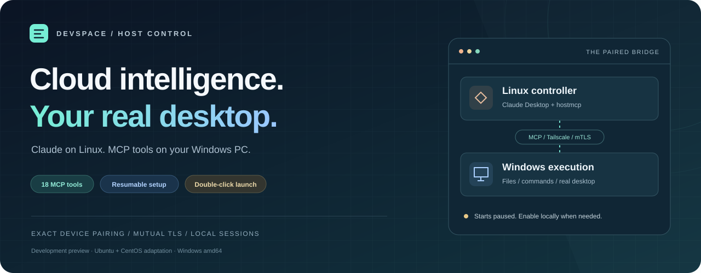
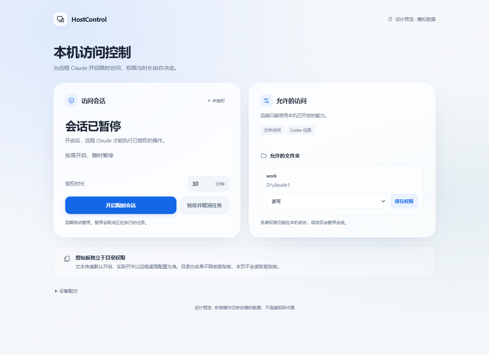
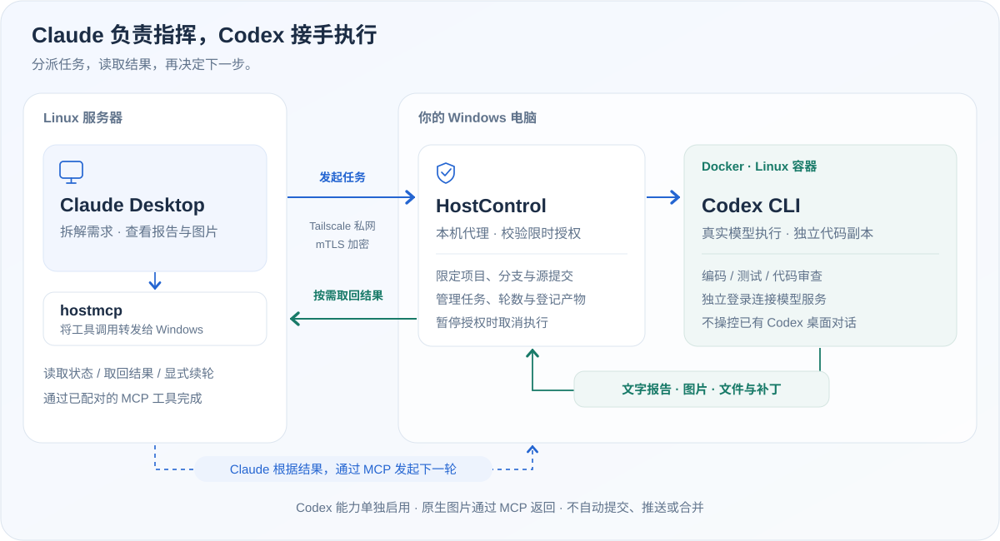

# DevSpace Host Control

<p align="center">
  <a href="#permissions"></a>
  <a href="#environments"></a>
  <a href="./LICENSE"></a>
</p>

<p align="center">
  
</p>

**在本地对话，让远端 Claude 思考，再把代码任务交给本机 Codex。**

- **自动部署**：Codex Skill 配置 Linux 桌面、Tailscale、证书配对与 MCP，支持中断续跑。
- **本地对话**：输入同步到远端 Claude，Enter 发送，文字和图片预览回到本地。
- **Codex 协作**：Claude 分派编码、测试或审查任务，读取报告和图片，继续指挥下一轮。
- **本机授权**：指定允许目录、读写权限和访问时长，随时暂停。

<a id="quick-start"></a>
## 🚀 快速开始

以下新功能位于 **`feat/claude-codex-orchestration`** 分支，尚未合并 main；旧版 `v0.2.0-beta.2` 安装包不包含这些更新。

获取当前分支，将 Skill 安装到 Codex：

```powershell
git clone --branch feat/claude-codex-orchestration --single-branch https://github.com/wcy-wcy1/devspace-host-control.git ./hostcontrol-source
$skillBase = if ($env:CODEX_HOME) { Join-Path $env:CODEX_HOME 'skills' } else { Join-Path $env:USERPROFILE '.codex/skills' }
New-Item -ItemType Directory -Force -Path $skillBase | Out-Null
Copy-Item -LiteralPath ./hostcontrol-source/skills/devspace-host-control -Destination $skillBase -Recurse
```

然后在 Codex 中说：

```text
使用 $devspace-host-control 自动部署。
先检查现有环境，复用已有配置；只开放我指定的文件夹，需要我登录时再问我。
```

首次按提示完成 Tailscale、Claude 登录和本机授权。已有安装请复用原配对，按 **Windows 代理 → Linux MCP 适配器** 的顺序升级。

<a id="environments"></a>
服务器支持 Ubuntu 22.04 / 24.04（amd64 / arm64），或明确选择的 CentOS Stream 9 原机适配（x86_64，非 Claude 官方支持系统）；本机为 Windows amd64。基础功能无需自行编译，**Codex 执行器另需 Docker Linux 容器、固定镜像与独立 Codex 登录**。

<a id="one-click"></a>
## 💬 日常使用

| 入口 | 用途 |
| --- | --- |
| `Start-Claude.cmd` | 启动或复用 Windows 代理，连接远程桌面并拉起 Claude |
| 本机控制页 | 确认权限，开启限时会话，暂停任务或撤销配对 |
| `Claude-Input.cmd` | 打开可选的本地对话面板 |

保留为这台设备生成的**完整启动目录**。代理默认暂停；代理、远程桌面和 Claude 需保持运行。

<a id="local-input"></a>
**同一个 Claude 会话可以持续多轮对话**：输入自动同步草稿，**Enter 发送、Shift+Enter 换行**，回复自动更新到本地。远端切换对话或修改草稿时会暂停；准备好空消息框后，点击「连接空对话」。已有草稿会保留，未知发送结果不会自动重发。

回复支持文字与有界 PNG 图片预览。图片来自匹配回复中可见区域的截图，**不是原图或 SVG 源文件下载**；需要保持远端 Claude 图片完整可见。操作细节见 [本地对话指南](skills/devspace-host-control/references/input-bridge.md)。

<details>
<summary>查看本地对话与授权页面</summary>




</details>

## 🤝 远端 Claude 指挥本机 Codex



Claude 选择本机批准的项目与源提交，通过 MCP 发起任务、查询状态，并取回文字报告、原生图片和文件。看完结果后，可显式发起下一轮。**文字分析直接返回文字；网页或界面检查才按需截图。**

这里运行的是 **Docker 内独立的 Codex CLI**，任务不会出现在 Codex 桌面聊天列表。测试返回实际退出码，编码返回独立副本的补丁，**不会自动提交、推送或合并**。

已在 Windows + CentOS 的真实 Claude Desktop 中验证「启动任务 → 读取浏览器截图中的随机数字 → 按图指挥第二轮 → 核对补丁」。这是固定公开 QA 仓库的验收，其它项目仍需单独验证。

[配置执行器](skills/devspace-host-control/references/codex-executor.md) · [真实联调记录](docs/claude-codex-acceptance.md)

<a id="permissions"></a>
## 🔐 权限边界

- 默认仅开放指定文件目录，可选只读或读写；保存权限后暂停会话，需重新授权。
- `codex` 为单独启用的能力，按项目、分支、任务类型与轮数限制；当前支持公开 HTTPS 仓库。
- 通用命令和桌面控制需另行开启，其权限不受文件夹白名单隔离。
- 文本剪贴板默认开启，是独立通道，不受目录白名单限制；低延迟输入通道不占用 Windows 剪贴板。
- 控制连接使用精确设备 Tailscale 策略与 mTLS。容器内任务可访问专用模型凭据和网络；项目不保证匿名或自动脱敏。

<a id="architecture"></a>
远程桌面为 **Windows → Linux / 3389**，工具调用为 **Linux → Windows / 7443**。Claude 普通联网使用服务器网络；本机 Codex 容器使用本机 Docker 网络。

<a id="mcp-tools"></a>
工具清单随本机权限提供；完整目录见 [模块说明](hostcontrol/README.md)，边界说明见 [权限与隐私](skills/devspace-host-control/references/privacy.md)。

<a id="guides"></a>
## 📚 更多指南

[部署与续跑](skills/devspace-host-control/references/automation.md) · [双击启动](skills/devspace-host-control/references/launcher.md) · [故障诊断](skills/devspace-host-control/references/troubleshooting.md) · [机房时区](skills/devspace-host-control/references/timezone.md) · [开发与打包](scripts/package.py)

[Apache-2.0](LICENSE)。基于对 [DevSpace](https://github.com/loft-sh/devspace) 的研究独立实现；非 DevSpace、Anthropic 或 OpenAI 官方产品。出处见 [NOTICE](NOTICE)。
