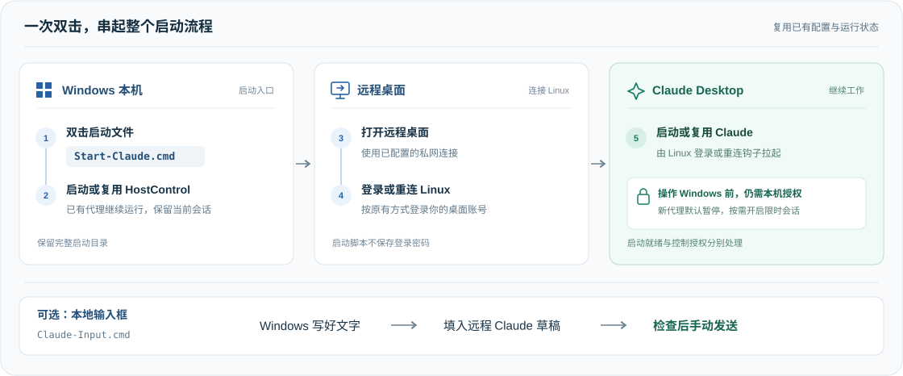
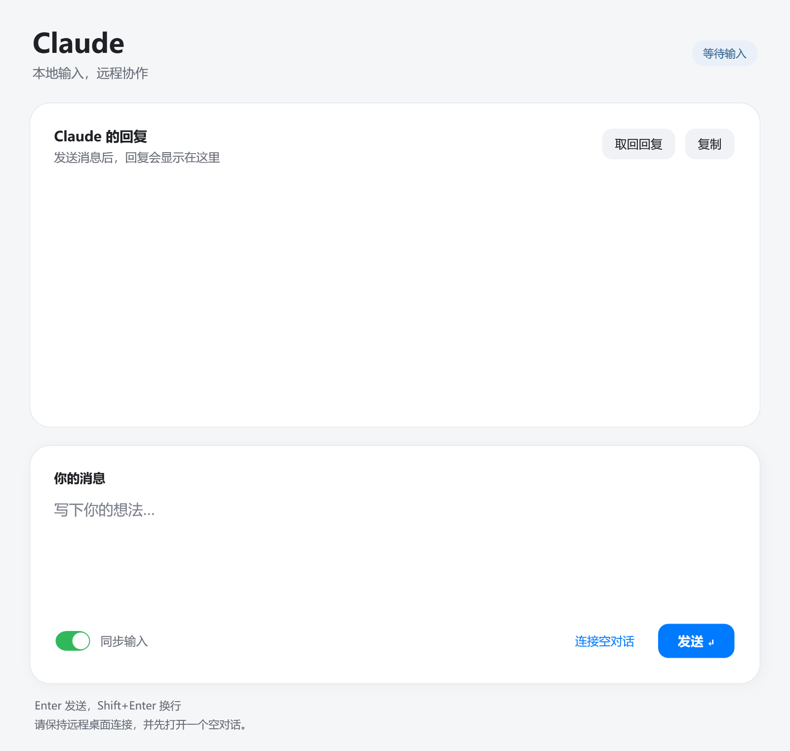
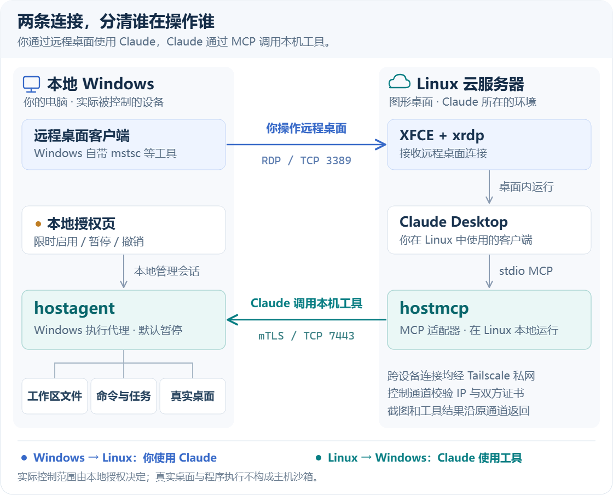

# DevSpace Host Control

<p align="center">
  <a href="https://github.com/wcy-wcy1/devspace-host-control/releases/tag/v0.2.0-beta.2"></a>
  <a href="#permissions"></a>
  <a href="#environments"></a>
  <a href="./LICENSE"></a>
</p>

<p align="center">
  
</p>

让服务器上的 **Claude Desktop** 通过 MCP 处理你的 Windows 文件，默认只访问你允许的目录；命令与桌面能力按需单独开启，安装、配对和日常启动交给 Codex Skill。

## 🧩 能做什么

- 🧭 **自动部署**：检查两端环境，配置 Tailscale、远程桌面和 MCP。
- 🔄 **接着继续**：复用已有安装与配对，部署中断后从未完成的步骤继续。
- 🖱️ **双击启动**：打开 `Start-Claude.cmd`，连接服务器并拉起 Claude。
- 📁 **目录由你选**：只开放指定文件夹，每个目录可选择只读或读写。
- 🔐 **授权在本机**：查看权限和剩余时间，随时暂停；Claude 只获得本机允许的工具。
- 📋 **文字互通**：默认双向文本剪贴板，也可以按需关闭。
- 💬 **本地输入框 · 实验性**：在 Windows 写好文字，填入远程 Claude 草稿后手动发送。

<a id="quick-start"></a>
## 🚀 快速开始

使用本页介绍的最新功能，下载 [**main 分支源码 ZIP**](https://github.com/wcy-wcy1/devspace-host-control/archive/refs/heads/main.zip)，将其中的 `skills/devspace-host-control` 安装到 Codex skills 目录。仓库已包含两端程序，无需自行编译：

```powershell
$skillBase = if ($env:CODEX_HOME) { Join-Path $env:CODEX_HOME 'skills' } else { Join-Path $env:USERPROFILE '.codex/skills' }
Expand-Archive -LiteralPath ./devspace-host-control-main.zip -DestinationPath ./hostcontrol-source
New-Item -ItemType Directory -Force -Path $skillBase | Out-Null
Copy-Item -LiteralPath ./hostcontrol-source/devspace-host-control-main/skills/devspace-host-control -Destination $skillBase -Recurse
```

然后在 Codex 中说：

```text
使用 $devspace-host-control，自动部署 Linux Claude Desktop 控制我的 Windows。
先检查现有环境，复用已有配置；只开放我指定的文件夹，缺少必要信息或需要我登录时再问我。
```

Codex 会执行安装、策略配置、证书配对和 MCP 配置。首次使用按提示完成 Tailscale / Claude 登录、系统授权与本机限时会话开启，后续复用已有配置。

已有部署请让 Codex 复用原配对升级两端程序，顺序为 **Windows 代理 → Linux MCP 适配器**。旧代理不支持新的权限发现协议。已发布的 [v0.2.0-beta.2 安装包](https://github.com/wcy-wcy1/devspace-host-control/releases/download/v0.2.0-beta.2/devspace-host-control.zip) 早于本次权限更新。

<a id="environments"></a>
## 🧭 选择部署环境

| 环境 | 系统 | 架构 | 说明 |
| :--- | :--- | :--- | :--- |
| **推荐服务器** | Ubuntu 22.04 / 24.04 | amd64 / arm64 | Claude Desktop 的主要安装路径 |
| **原机适配** | CentOS Stream 9 | x86_64 | 项目提供兼容适配，需明确选择；非 Claude 官方支持系统 |
| **本机电脑** | Windows | amd64 | 保持桌面登录，运行 HostControl |

运行成品无需 Go SDK、Docker 或 Kubernetes。部署时会按确认的机房地区配置服务器时区。

<a id="one-click"></a>
## 🖱️ 日常启动

保留为这台设备生成的**整个启动目录**，以后双击 **`Start-Claude.cmd`** 即可：

<p align="center">
  
</p>

已有代理继续运行；新代理默认暂停，需要操作 Windows 时在本机开启限时会话。详细配置见 [双击启动指南](skills/devspace-host-control/references/launcher.md)。

<a id="permissions"></a>
## 🔐 权限由本机决定

在 Windows 代理显示的私有本机控制页，确认允许目录和读写权限，再开启限时会话：

| 你来决定 | 实际行为 |
| :--- | :--- |
| **访问哪个目录** | 远端使用工作区别名和相对路径，文件工具拒绝越界访问 |
| **只读还是读写** | 只读目录拒绝写入、移动；远端不能自行扩大权限 |
| **何时开始、何时停止** | 会话默认暂停，可查看剩余时间，随时暂停或撤销配对 |
| **修改权限后怎么办** | 保存到本机配置并暂停会话，由你重新开启授权 |

默认仅启用文件能力。命令执行和桌面控制需要单独开启，其权限不受文件夹只读设置约束。文本剪贴板是独立通道，默认开启，不受目录白名单限制。详见 [访问与隐私边界](skills/devspace-host-control/references/privacy.md)。

<a id="local-input"></a>
## 💬 在本地输入，交给远程 Claude

可选配置完成后，双击 **`Claude-Input.cmd`** 打开本地输入框：

**本地写字 → 点击「填入远程 Claude」→ 在 Claude 中检查并发送。**

<p align="center">
  
</p>

支持中文和多行文字；远程已有草稿时会提示先处理，避免覆盖。保持远程桌面连接，文字通过已有的文本剪贴板通道传递，无需额外开放端口。

> 实验性功能：离线测试已通过，真实 Claude 中的中文多行传递仍待验收。仅填入草稿，不自动发送或同步回复；首次配置后需保存工作并重新打开 Claude。

配置与验证见 [本地输入框指南](skills/devspace-host-control/references/input-bridge.md)。

<a id="mcp-tools"></a>
## 🧰 MCP 工具

下表是完整工具目录。Claude 实际看到的清单由 Windows 本地权限决定；禁用能力不公布，无法确认权限时拒绝访问。

| 能力 | 工具 | 开放方式 |
| :--- | :--- | :--- |
| **会话状态** | `host_status` · `session_info` | 已认证设备可查询 |
| **工作区文件** | `fs_list` · `fs_read` · `fs_write` · `fs_move` | 默认启用，按目录权限提供 |
| **程序任务** | `exec_start` · `exec_poll` · `exec_cancel` | 单独开启 `exec` |
| **桌面观察** | `desktop_windows` · `desktop_inspect` · `desktop_capture` | 单独开启 `desktop` |
| **鼠标键盘** | `desktop_focus` · `desktop_click` · `desktop_type` · `desktop_key` · `desktop_scroll` | 单独开启 `desktop` |
| **打开网页** | `browser_open` | 单独开启 `desktop` |

目录全部只读时，清单只保留状态查询、`fs_list` 和 `fs_read`。即使客户端缓存了旧清单，每次调用仍由 Windows 重新检查权限。

<a id="architecture"></a>
## 📐 工作原理

<p align="center">
  
</p>

两端通过 Tailscale 私网连接，分别处理远程桌面和工具调用：

| 通道 | 方向 | 用途 |
| :--- | :--- | :--- |
| **RDP · TCP 3389** | Windows → Linux | 你在远程桌面使用 Claude Desktop |
| **MCP / mTLS · TCP 7443** | Linux → Windows | Claude 调用 HostControl 执行本机操作 |

`hostagent` 运行在 Windows；`hostmcp` 由 Linux Claude Desktop 启动；`hostctl` 负责两端证书配对。Codex Skill 组织部署和维护流程。

Claude 的普通联网请求使用 Linux 服务器网络，本项目不额外配置公网代理。目录授权约束的是 Windows 文件工具，不承诺隐藏 Tailscale 等管理连接的公网端点。

<a id="guides"></a>
## 📚 使用指南

[自动化与续跑](skills/devspace-host-control/references/automation.md) · [部署与配对](skills/devspace-host-control/references/operations.md) · [双击启动](skills/devspace-host-control/references/launcher.md) · [故障诊断](skills/devspace-host-control/references/troubleshooting.md) · [时区配置](skills/devspace-host-control/references/timezone.md) · [权限与隐私](skills/devspace-host-control/references/privacy.md) · [本地输入框](skills/devspace-host-control/references/input-bridge.md)

开发入口：[Go 模块](hostcontrol/) · [Skill 源码](skills/devspace-host-control/) · [发布打包](scripts/package.py)。

## 📄 许可

[Apache-2.0](LICENSE)。源自对 [DevSpace](https://github.com/loft-sh/devspace) 的源码研究，独立实现主机控制模块；不是 DevSpace 或 Anthropic 的官方产品。出处见 [NOTICE](NOTICE)。
