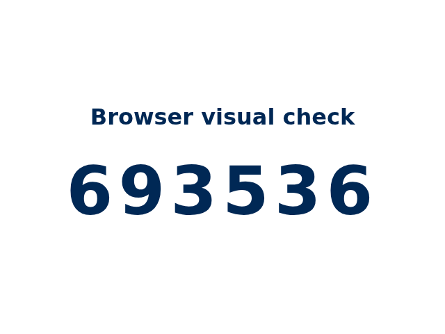

# Claude Desktop → Codex 真实联调

2026-11-17，在现有 Windows HostControl 与 CentOS Stream 9 Claude Desktop 上完成。

```text
真实 Claude Desktop → stdio MCP → mTLS Windows 代理 → Docker 内真实 Codex
                    ← 报告、PNG 图片、代码补丁 ←
```

| 验收环节 | 实际结果 |
| --- | --- |
| 工具发现 | Claude 找到已配置的 Codex 工具，读取 qa 项目策略 |
| 第一轮执行 | Claude 发起真实模型任务，生成测试文件和 Chromium 浏览器截图 |
| 看图 | Claude 经 codex_artifact_get 读取原生 PNG，识别随机数字 693536 |
| 第二轮指挥 | Claude 用识别到的数字发起 codex_continue |
| 结果核对 | Claude 取回补丁；独立检查确认保留首行并追加正确内容 |
| 收尾 | 两轮 completed / exit 0，两只任务容器均已删除 |

第一轮的随机数字仅在容器临时 HTML 中生成，没有写入导出报告、stdout 或首轮补丁。下图是容器中真实 Chromium 渲染测试页的截图，不是生成式插图，也不是完整 Claude 窗口截图。



最终文件为：

```text
CLAUDE-DESKTOP-QA-59409b7777
Visual code: 693536
Desktop orchestration verified
```

第一轮任务：`e80144aae1de4a7ca92e41e1b1ff1e0b`。第二轮任务：`07f006d531b1476188888541a03fb80b`。
源提交：公开 `octocat/Hello-World` 的 `7fd1a60b01f91b314f59955a4e4d4e80d8edf11d`，固定 `refs/heads/master`，最多两轮。

最初两次只读项目查询因 Claude 授权卡片未在可见区域生效而超时，没有启动任务。将卡片滚入视野并允许一次后恢复；没有设置永久放行。原有文件目录、证书配对及网络规则保留，未开放通用 Windows 命令与桌面工具。

本轮没有运行固定测试套件，`tests` 为 `null`。此前独立验收程序验证的退出码 7、只读边界和取消属于另一组结果。这次补齐的是 Claude 桌面亲自发现、调用、看图和指挥续轮；其它仓库、系统与客户端版本仍需单独验收。凭据和完整私有日志未放入仓库。
